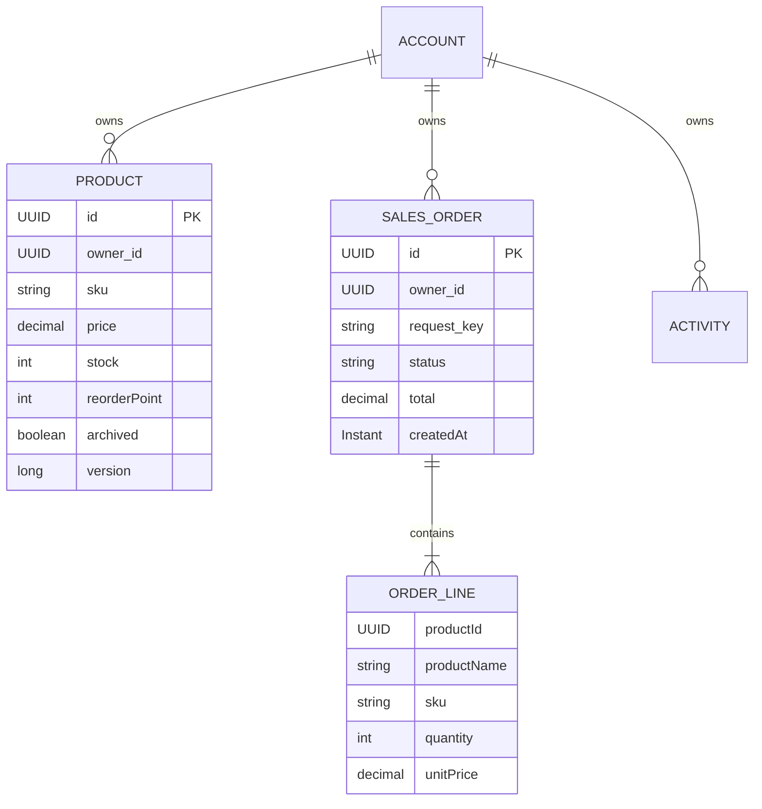

# Architecture and decisions

## Data model

Ownership columns are UUID values; repository queries explicitly scope them to the authenticated principal. They are not client-provided ownership fields. Order lines are JPA embeddables in a collection table and retain a snapshot of name, SKU and price. Products are soft-archived, so cancellation can restore stock even when the product is no longer in the active catalog.

## Order request, step by step

1. Browser constructs an `OrderInput` and one random `Idempotency-Key` when opening the order form. The key is retained for retries while that form remains open.
2. Security requires an authenticated session and validates the CSRF header on the POST.
3. Bean Validation checks the customer, email, line count and quantities before the service runs.
4. The controller derives the owner UUID from the authenticated principal, never the JSON body.
5. The transactional service obtains a pessimistic write lock on that owner's account row. This serializes that workspace's order creation, stock changes, cancellation, and duplicate-key checks.
6. A matching request key with identical input returns the existing order. Different input produces 409. A database unique constraint on `(owner_id, request_key)` is an additional invariant.
7. Repeated product lines are merged, products are loaded for the owner, stock is checked, and prices are taken from the database. Client totals are not trusted.
8. The service deducts stock, captures line snapshots, inserts the order and activity, then commits everything together. If any product fails, the entire transaction rolls back.
9. The controller returns an `OrderView`; the frontend refreshes its dashboard from the server.

### Why a workspace lock?

It is deliberately simple. An account row always exists before a mutation, so there is one stable lock target even when an idempotency key has not been inserted yet. It solves simultaneous duplicate creation and stock changes using the database rather than an in-memory Java `synchronized` block. Separate workspaces use separate locks. The limitation is that unrelated products in one busy workspace still wait for each other. A larger system could lock individual inventory rows in deterministic order and implement an idempotency table/unique-insert protocol, with deadlock/serialization retry handling. No high-throughput claim is made here.

`@Version` detects stale writes to product entities as an additional guard; the concurrency strategy used for normal workspace mutations is the account-row lock, not optimistic retries.

### Cancellation

Only PLACED orders can become CANCELLED. The service holds the same owner lock, restores all quantities, changes status, and logs the event in one transaction. Repeating the same status request is a no-op; changing a terminal status is rejected. A stock limit violation rolls the transaction back.

## Security

- Same-origin browser application, so session authentication is a straightforward fit. JWT would add refresh/revocation complexity without providing a needed feature here.
- Password hashes use BCrypt; no password is stored in frontend storage. UTF-8 password byte length is checked before BCrypt.
- The HttpOnly session cookie is marked SameSite=Lax; the HTTPS demo profile also marks it Secure. Session IDs rotate after sign-in.
- Default Spring Security CSRF protection stays enabled. `/api/auth/csrf` supplies the masked token for mutation headers.
- Every read/mutation uses the principal's UUID. Supplying another workspace's product/order ID does not grant access.
- A visitor may create a DEMO principal with a separate dataset. Registered accounts have OWNER authority. Both own their entire workspace; this is not a multi-user role-management application. Reset additionally checks the persisted demo flag.
- A basic auth-endpoint rate limit bounds requests per address per minute within one process. It does not replace a gateway/WAF.
- The frontend escapes server-controlled strings before placing them in HTML, uses no third-party runtime scripts, and has a restrictive Content Security Policy.
- The app does not expose the H2 console or account password hashes. Health does not expose connection details. Input errors use Problem Details where handled by application advice.

## Storage and deployment tradeoffs

Local H2 file storage persists between local restarts. The free live demo uses H2 in memory because free Render filesystem storage is ephemeral and its free PostgreSQL expires. This avoids a resume demo silently failing after a database expiry, but intentionally resets all data on server restart. The UI and README disclose it. PostgreSQL is configurable but has not been tested in this delivery unless the verification report explicitly says so.

Hibernate schema generation keeps setup beginner friendly. A real production release needs versioned migrations, backups, account recovery, privacy/retention policy, and durable database provisioning. CI uses H2; a PostgreSQL Testcontainers test suite is a useful next milestone.

## Why one deployable app?

A modular Spring Boot monolith keeps the request path easy to debug, avoids CORS and split deployment failures, and fits a free instance. Controller/service/repository boundaries leave room for future extraction. Microservices would need a concrete scaling or ownership requirement to justify distributed transactions, service discovery and network failure handling.

## Frontend

Plain JavaScript uses `fetch` against real REST endpoints. It has separate dashboard, inventory, orders and activity views; accessible native dialogs and forms; debounced product search; server-side inventory pagination; responsive CSS; loading, empty, error and success states. There are no fabricated KPI increments: displayed values come from persisted records. The browser's order preview uses floating-point arithmetic for display only; authoritative totals are computed with Java `BigDecimal` on the server.
